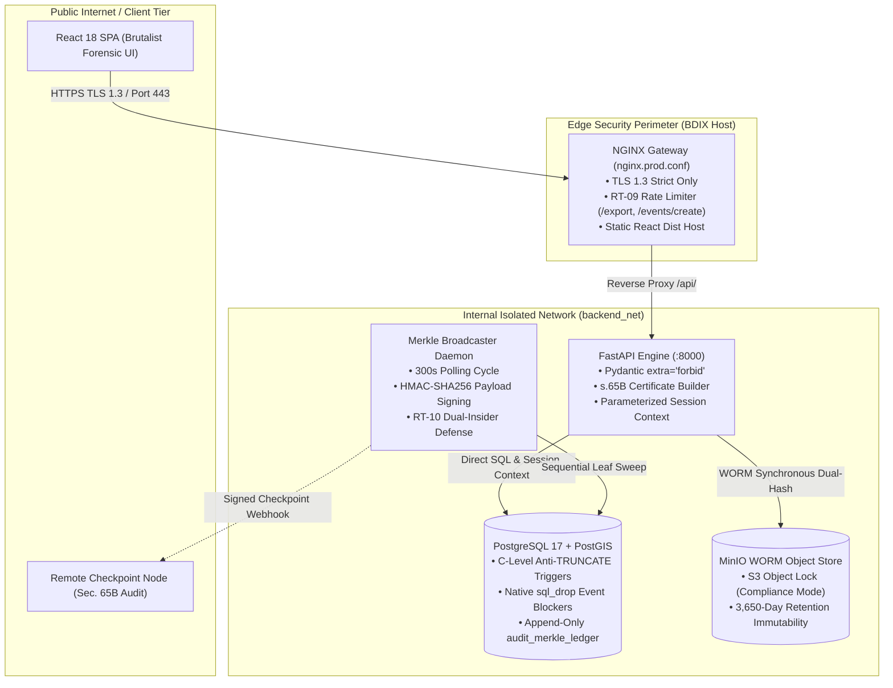

# Attilan: Criminal Intelligence & Cryptographic Evidence Integrity Platform

> **Stage D Production Pilot**: Append-Only Merkle Ledger, WORM S3 Object Storage, and Deterministic Entity Disambiguation for High-Assurance Evidence Administration.

[](https://github.com/tazwaryayyyy/Attilan/actions/workflows/adversarial-ci.yml)
[](LICENSE)
[_Act_2022_s.65B-emerald.svg)](res%20gotham.md)
[](database/schema_stage1.sql)

---

## 1. Executive Summary: Evidence Integrity Over "Predictive Policing"

Attilan is an open-source, compartmentalized criminal intelligence and evidence chain-of-custody platform designed for low-cost, high-assurance BDIX infrastructure.

Traditional law enforcement systems emphasize centralized surveillance, probabilistic facial recognition, and opaque "predictive policing" scoring—methodologies that fail under cross-jurisdictional scrutiny, generate systemic bias, and are legally vulnerable to evidence suppression. 

**Attilan inverts this paradigm**:
- **Mathematical Immutability**: All judicial orders, FIR entries, and investigative records are bound to an append-only, cryptographic Merkle Hash Tree (`audit_merkle_ledger`).
- **Cryptographic Intake & Provenance**: Incoming primary source documents are dual-hashed synchronously via **SHA-256** and **BLAKE3**, and locked in S3 WORM storage under 10-year (3,650-day) Compliance Mode retention.
- **Strict Epistemological Boundaries**: Entities and relationships are bound to evidentiary stages (`evidentiary_status`). An allegation is never visually or structurally conflated with an adjudicated conviction.
- **Evidence Act 2022 Section 65B(4) Automation**: The engine dynamically compiles verifiable Section 65B(4) Certificates of Authenticity with cryptographic manifests for direct judicial submission.

---

## 2. System Architecture & Topology



---

## 3. Epistemic Safeguards & Anti-Bias Design Principles

1. **Deterministic Entity Disambiguation**: Automated record merging is cryptographically and procedurally blocked. The Bengali Disambiguation Evaluator mandates a strict 3-point matching pipeline (Phonetic normalization, Levenshtein distance, NID/case alignment) followed by human-in-the-loop analyst confirmation.
2. **Context-Enforced Graph Edges**: Unproven assertions labeled with generic terms (e.g., "Associate" or "Co-Conspirator") are rejected at the database and rendering tiers. All edges require explicit statutory provenance (e.g., `CO-NAMED IN FIR NO. 12 [UNPROVEN]`).
3. **Soft-Tombstone Integrity**: In compliance with judicial expungement mandates, entities and events are never dropped with destructive SQL `DELETE`. The platform supersedes records via `is_superseded = TRUE`, preserving the original audit trail and linking the superseding court judgment UUID.

---

## 4. Statutory Disclaimer

> ### IMPORTANT LEGAL DISCLAIMER
> **Attilan is strictly an evidence provenance and chain-of-custody engine.**
> 
> Under no circumstances should this platform be configured, extended, or deployed for:
> - Automated "guilt scoring", risk indexing, or predictive recidivism modeling.
> - Mass facial recognition or autonomous biometric profiling.
> - Unsupervised entity merges or bulk public dossier scraping.
> 
> Cryptography guarantees **Data Integrity** (proof that an uploaded record has remained unaltered since intake). It does **not** guarantee **Data Veracity** (whether the statement contained in the original police report is factual). Judicial scrutiny and constitutional due process remain mandatory.

---

## 5. Production Quickstart (BDIX VPS Deployment)

### Prerequisites
- Docker Engine 26.0+ & Docker Compose v2.20+
- Valid TLS Certificates placed in `nginx/certs/` (`fullchain.pem`, `privkey.pem`)
- BDIX VPS with minimum 4 vCPU, 8 GB RAM, 100 GB NVMe

### 1. Environment Configuration
Clone the repository and copy the environment template:
```bash
git clone https://github.com/tazwaryayyyy/Attilan.git
cd attilan
cp .env.example .env
```

Ensure the following cryptographic and database secrets are bound:
```env
POSTGRES_USER=postgres
POSTGRES_PASSWORD=your_hardened_db_password
POSTGRES_DB=opencase_bd

MINIO_ROOT_USER=minio_admin_user
MINIO_ROOT_PASSWORD=your_hardened_minio_password
MINIO_EVIDENCE_BUCKET=evidence_bucket

JWT_SECRET_KEY=generate_with_openssl_rand_hex_32
APP_PRIVATE_SIGNING_KEY=generate_with_openssl_rand_hex_64
REMOTE_AUDIT_WEBHOOK_URL=https://syslog.audit-external.bd/checkpoint
```

### 2. Launch Production Environment
```bash
# Build frontend assets and launch containers
npm --prefix frontend run build
docker compose -f docker-compose.prod.yml up -d --build
```

### 3. Verify Health & Security Perimeter
```bash
# Inspect container health states
docker compose -f docker-compose.prod.yml ps

# Confirm NGINX TLS 1.3 and HSTS headers
curl -I https://localhost/health

# Confirm PostgreSQL Native Drop Blockers
docker exec -it opencase_db_core psql -U postgres -d opencase_bd -c "DROP TABLE audit_merkle_ledger;"
# Output: ERROR: PERMISSION DENIED: Dropping table audit_merkle_ledger is prohibited by Section 9 Evidence Integrity Architecture.
```

---

## 6. Threat Model Verification

Our automated CI test suite verifies the system against the 12 Red-Team Scenarios outlined in `res gotham.md`:

```bash
# Run the adversarial Red-Team suite locally
PYTHONPATH=. pytest backend/tests/test_adversarial_redteam.py -v
```

| Attack Scenario | Simulated Threat Vector | Control Evaluated | Outcome |
| :--- | :--- | :--- | :--- |
| **RT-01** | Fabricated Lawfare FIR Injection | District Cause-List Token Cross-Check | **BLOCKED (Quarantined)** |
| **RT-02** | Privileged Rogue DBA Table Truncation / Drop | C-Level Event Triggers & Function Defenses | **DEFEATED (Permission Denied)** |
| **RT-04** | False Identity Auto-Merge Collision | Deterministic Bengali Disambiguation Engine | **PASSED (Auto-Merge Prohibited)** |
| **RT-09** | Bulk Record Exfiltration | NGINX `limit_req_zone` (5 req/min on `/export`) | **THROTTLED (HTTP 429)** |
| **RT-10** | Dual-Insider Audit Log Tampering | HMAC-SHA256 Merkle Syslog Forwarder | **DEFEATED (Sequential Leaf Break Alert)** |

---

## 7. License

Licensed under the **Apache License, Version 2.0**. See [LICENSE](LICENSE) for details.
